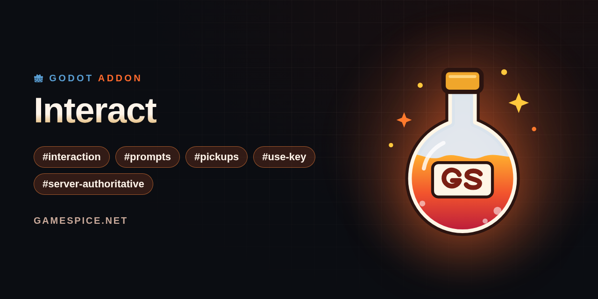

[](https://moddingcommunity.com/a/141-gs-interact)

Godot 4.7+ addon for press-to-use interaction: focus selection, prompts, hold-to-use, range and line-of-sight rules, and server-validated use requests for doors, buttons, pickups and vehicles. Part of the [GameSpice](https://github.com/gamespice-platform) family. It needs only [GameSpice Core](https://github.com/gamespice-platform/core).

gs-interact is a [GameSpice](https://gamespice.net) addon (MIT, built with Claude Code). Its headless suite is `examples/interact_selftest.tscn`. The collection at [Zee's Games](https://zeesgames.com) is built on the GameSpice addons and runs on live servers, though this addon has not been adopted by a game yet.

This first slice is the decisions, as pure code a client and a server share: which candidate the use key would act on, a hold-to-use state machine for a progress ring, and the server's verdict on a use request. What a use does (open the door, give the item) stays with the game.

## Install

1. Copy `addons/gs_interact/` and `addons/gs_core/` into your project.
2. Enable gs-interact in *Project > Project Settings > Plugins*.

## Quick start

```gdscript
var cfg: GSInteractConfig = GSInteractConfig.from_files().value
var hold := GSInteractHold.new()

# Client, each frame: measure candidates, pick one, show its prompt
var candidates: Array = []
for t in nearby_targets:
    candidates.append({"id": t.name, "distance": eye.distance_to(t.global_position),
        "angle": view_angle_to(t), "visible": has_line_of_sight(t), "priority": t.priority})
var index := GSInteractFocus.pick(cfg, candidates)
var focused: StringName = &"" if index < 0 else candidates[index]["id"]
if pressed_use and focused != &"":
    hold.begin(cfg, focused, target_hold_seconds)
if hold.tick(delta, use_held, focused):
    send_use_request(focused)
ring.value = hold.progress()

# Server: measure it yourself, never trust the client's numbers
var verdict := GSInteractRequest.validate(cfg, {"distance": d, "visible": los, "now": now, "last_use": last[actor]})
if not verdict.ok:
    reject(actor, verdict.error.message)
```

## Settings

Every number is a field on `GSInteractConfig`. The values below are defaults, and the ranges are inspector slider limits, not enforced caps. Set the property from code or a config file to go beyond them.

| Setting | Default | What it does |
| --- | --- | --- |
| `enabled` | true | Off, nothing is focusable and every request is refused. |
| `range_m` | 2.5 | Metres a target may be used from, unless it declares its own. |
| `focus_angle` | 35.0 | Half-angle of the focus cone in degrees; 0 is any direction. |
| `require_line_of_sight` | true | A target must be in sight to be focused or used. |
| `max_candidates` | 0 | Candidates one pick considers, nearest first; 0 is every one. |
| `hold_seconds` | 0.0 | Default hold time; 0 is an instant press. |
| `cooldown_seconds` | 0.25 | Seconds before the same actor may use again. |
| `prompt_key` | E | Key name shown in the prompt. |
| `prompt_locked_suffix` | empty | Appended to the label of a locked target. |
| `server_range_slack` | 0.5 | Metres the server adds to the range to forgive latency. |

Layers, weakest first: the defaults, `cfg/addon/gs_interact/*.yml`, the game's files, the operator's files, `GS_INTERACT_*` environment variables, then `--interact-*` flags.

## What it is not

- Not the input: GameSpice Input owns the `use` action and its rebinding. Pass its pressed and held state in.
- Not the camera or the view ray: the game measures distance, angle and line of sight and passes them in.
- Not the prompt art: GameSpice UI and GameSpice HUD draw the prompt and the progress ring from `progress()` and the focused id.
- Not what a use does: opening a door, taking an item or entering a seat is game code, or GameSpice Vehicle for seats. This addon says whether and when.
- Not a trust boundary on its own: the server must measure the world itself and call `GSInteractRequest.validate` with what it measured.

## Used by

No shipped game uses it yet; the example scene shows it.

The whole collection is at [zeesgames.com](https://zeesgames.com).

## Licence

MIT.
